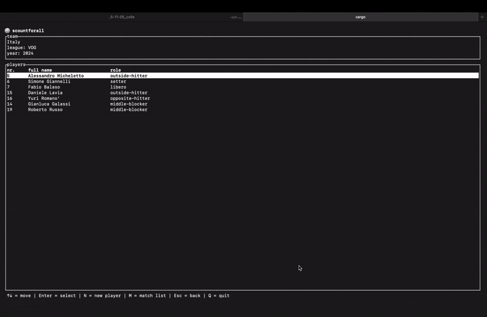

# scout4all

**scout4all** is a CLI tool for collecting, managing and reporting volleyball match data.  
It helps coaches and analysts track match events and generate useful reports for post-game analysis.

## reporting features

- **match summary**: automatically generates a summary of each match, including scores, rotations and key events; statistics can be broken down by phase and by individual rotation
- **player statistics**: provides per-player stats such as points, errors, substitutions and general efficiency
- **custom filters**: filter reports by player, event type, set, phase or rotation

## requirements

- rust (stable)
- terminal compatible with [crossterm](https://github.com/crossterm-rs/crossterm)
- Linux, macOS, or Windows

## contributing

Pull requests and bug reports are welcome!

## community & support

💬 **join our discord community**:

Connect with other coaches, analysts and developers using **scout4all**.  
Get help, share insights and stay updated on the latest releases!

## contributors

- [Nicola Baldi](https://github.com/naighes)
- [Luca Giordano](https://github.com/lsfera)
- [Tyler Widdison](https://github.com/tyler-widdison)

## license

Copyright (C) 2025-2026 Nicola Baldi and contributors.

This project is licensed under the **GNU Affero General Public License v3.0 only** (AGPL-3.0-only).  
You are free to use, modify and distribute this software, as long as you keep the copyright notice
and release your changes under the same license, with their source code: also when you offer them
as an online service.
See the [LICENSE](./LICENSE) file for details.

## data and privacy

Unless you turn it off in the settings, the matches you scout are sent to the developer, without
names, for statistics and to diagnose bugs. See the [DATA-PRIVACY](./DATA-PRIVACY) file for details.
