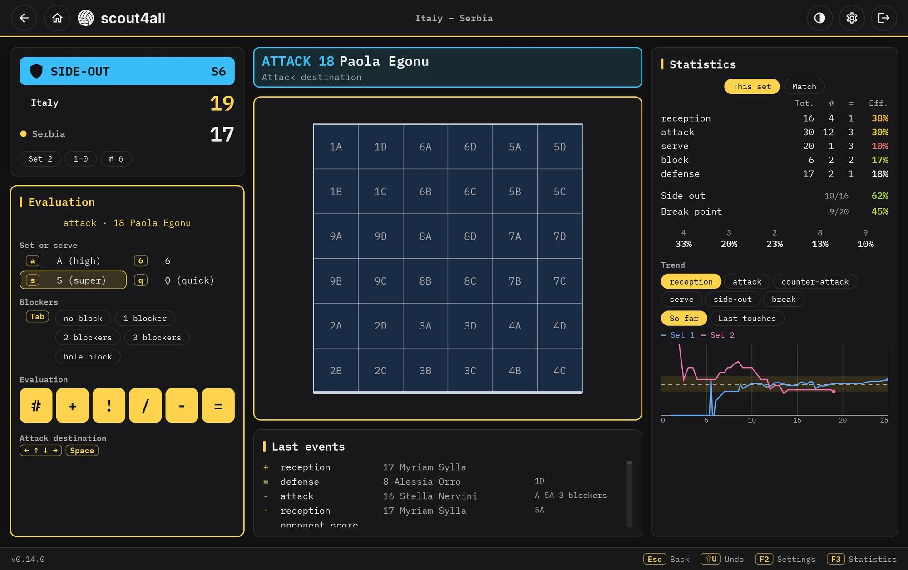
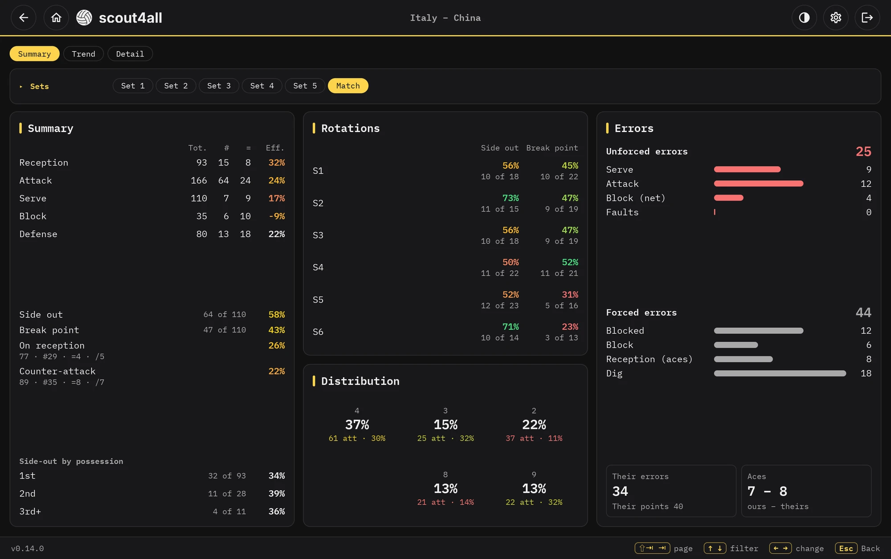
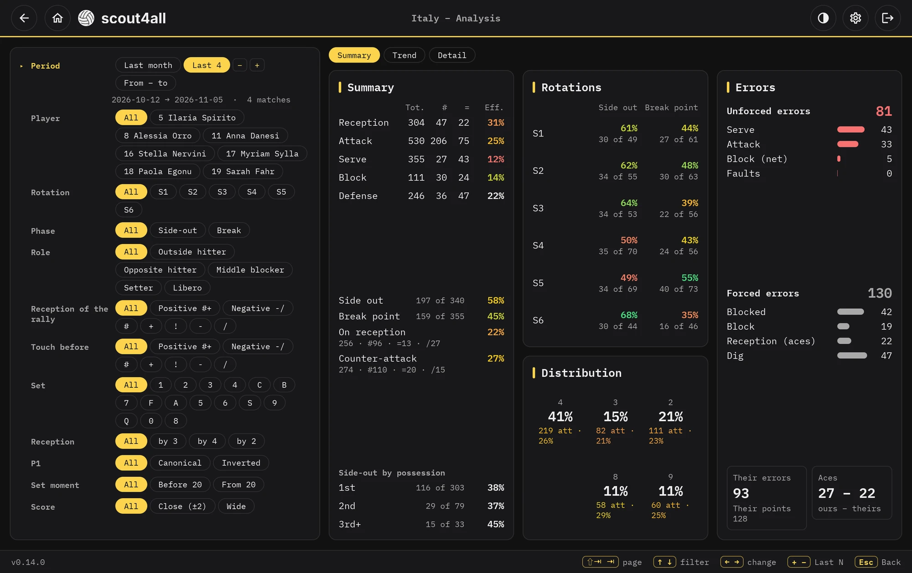
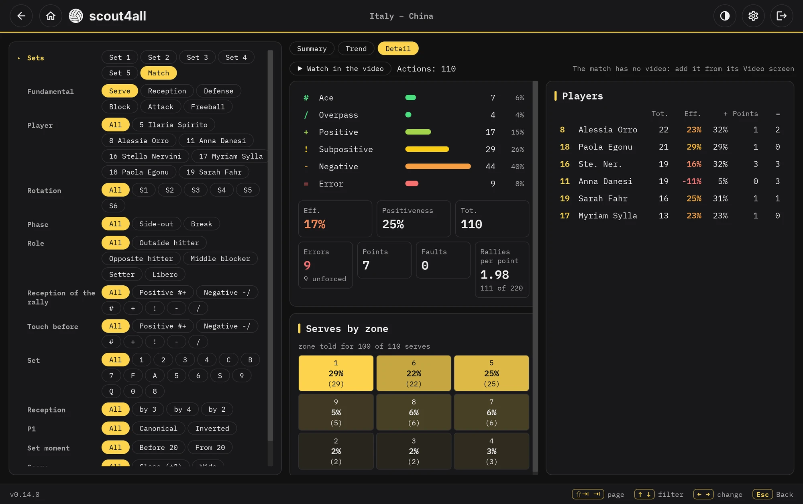
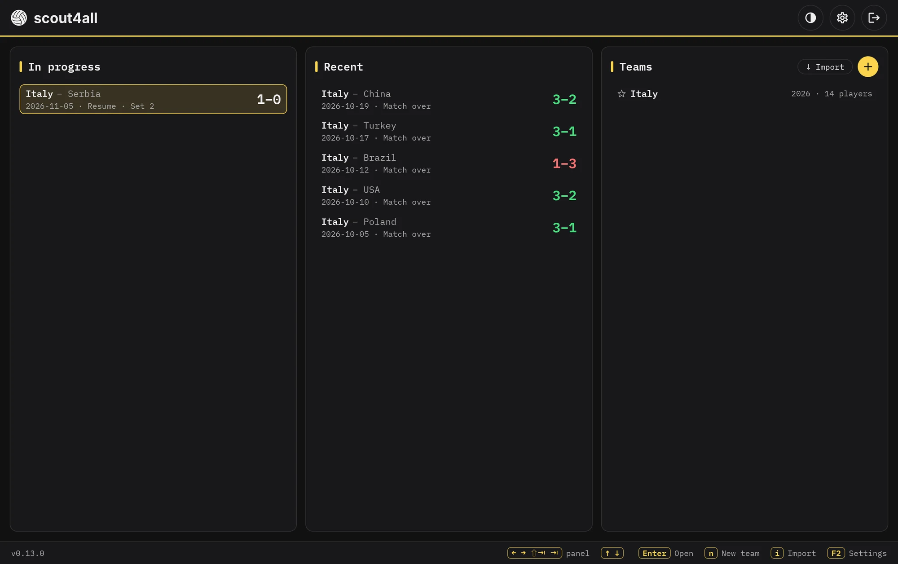

# scout4all

**scout4all** is a free, open source app for volleyball scouting. It's built to cut the time it
takes to record events while scouting, with an interaction designed mainly for the keyboard, but
usable with a mouse or other devices too. The data you collect let you check statistics and
analyze performance, during and after the match: side-out and break point, rotations,
distribution, zones and trends over the season.

It runs on **Windows, macOS and Linux**; an **Android** app is in testing.

🌐 [Website and downloads](https://naighes.github.io/scoutforall/)



## features

- **scouting from the keyboard**: pick the event, the player and the evaluation; the app follows the rotation, the phase and the libero, offers only what makes sense and keeps the score
- **zones of play**: serve and attack destination, reception, dig and block zones on a grid, plus set tempo and number of blockers, all optional
- **substitutions, libero and setter changes**, undo and correction of any event of the set
- **match statistics**, while scouting and afterwards: efficiency and positivity of each fundamental, side-out and break point by rotation, setter distribution, errors, trends rally by rally; filters by set, player, rotation, phase, role and quality of the reception
- **team analysis** over several matches (the last month, the last N, any period), with match-by-match trends
- **DataVolley import** (`.dvw`), with zones
- **PDF report** laid out as a scoresheet
- **export and import** of teams and matches, to share them with colleagues
- **customizable keys**, five languages (English, Italian, Portuguese, Polish, Japanese), light and dark theme
- **automatic updates**: at startup the app checks for a new version and, if you agree, installs it and restarts

| match statistics | team analysis |
| --- | --- |
|  |  |
|  |  |

## download

Get the latest version for your system from the [website](https://naighes.github.io/scoutforall/#download) or from the [releases](https://github.com/naighes/scoutforall/releases/latest).  
Coming from the old terminal version? Nothing to do: at its next start it offers to update and installs the desktop app in its place, with all your teams and matches.

## data folder

Teams, matches and settings are saved in the `.scout4all` folder of your home directory. To keep
them somewhere else, set the `SCOUT4ALL_DATA_DIR` environment variable to another folder.

## building from source

Requirements: [Rust](https://rustup.rs/) stable (1.92 or later).

```sh
cargo run --release --package scout4all-desktop
cargo test --workspace
```

The repository:

| folder | what it is |
| --- | --- |
| `core/` | the domain, independent of the user interface: lineup, replay of the events, statistics, PDF report, persistence |
| `desktop/` | the desktop app (Windows, macOS, Linux), written with [iced](https://iced.rs/) |
| `keys/` | the keys of the scouting, shared by the apps with a keyboard |
| `mobile/` | the bindings of the core for the native apps, generated with [UniFFI](https://mozilla.github.io/uniffi-rs/) |
| `android/` | the Android app, in Jetpack Compose: see [android/README.md](android/README.md) |
| `web/` | the [website](https://naighes.github.io/scoutforall/), built with [Astro](https://astro.build/) |
| `bench/` | how long the app takes on large archives: see `scripts/bench.sh` |
| `scripts/` | the tools of the project, below |

### scripts

Each one says at its top what it does, its options and what it needs.

| script | what it does |
| --- | --- |
| `scripts/test.sh` | the tests as the CI runs them, in several time zones (UTC, Rome, Tokyo, Los Angeles); arguments go to `cargo nextest` |
| `scripts/bench.sh` | the times of the reads, of the statistics and of the scouting on large archives made of real DataVolley matches (downloaded once into a cache); `generate DIR [TxM]` keeps such an archive to try the apps on it, `measure DIR` times the reads on a data folder, `scouting DIR` the scouting of the match in progress of such an archive, `reports DIR OUT` writes the statistics of every match to compare them (`diff -r`) before and after a change |
| `scripts/clean-target.sh` | takes the stale build artifacts out of `target/`, which cargo never does and which grows into hundreds of GB: lists what would go and how much, `--apply` removes it, `--days N` sets what is stale (default 7 days), `--all` is `cargo clean`; the next build recompiles what was removed |
| `scripts/release.sh` | releases the next version (`major`, `minor` or `patch`) from master: bump, commit, tag, push |
| `scripts/generate_screenshots.py` | the screenshots (and the video) of the desktop app for the site, in every language |
| `scripts/generate_phone_screenshots.py` | the screenshots of the Play listing, in every language, from the phone connected with USB debugging |
| `scripts/country_names.py` | writes `core/src/shapes/country_names.rs`, the names of the countries in the languages of the app, from the CLDR data |

## contributing

Pull requests and bug reports are welcome!

## community & support

💬 **join our discord community**:
[](https://discord.gg/EMv79fdWFf)

Connect with other coaches, analysts and developers using **scout4all**.  
Get help, share insights and stay updated on the latest releases!

## contributors

- [Nicola Baldi](https://github.com/naighes)
- [Luca Giordano](https://github.com/lsfera)
- [Tyler Widdison](https://github.com/tyler-widdison)

## license

Copyright (C) 2025-2026 Nicola Baldi and contributors.

This project is licensed under the **GNU Affero General Public License v3.0 only** (AGPL-3.0-only).  
You are free to use, modify and distribute this software, as long as you keep the copyright notice
and release your changes under the same license, with their source code: also when you offer them
as an online service.
See the [LICENSE](./LICENSE) file for details.

## data and privacy

Unless you turn it off in the settings, the matches you scout are sent to the developer, without
names, for statistics and to diagnose bugs. See the [DATA-PRIVACY](./DATA-PRIVACY) file for details.
